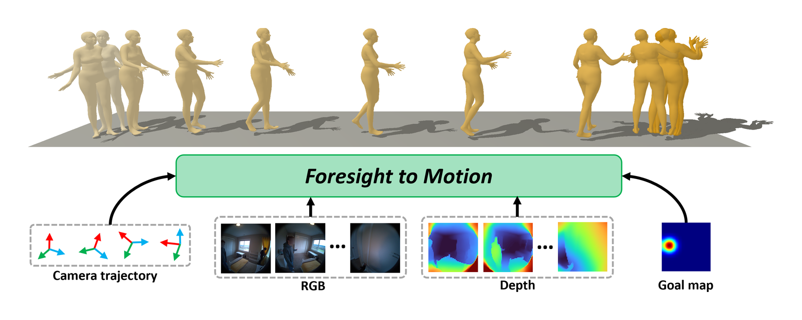
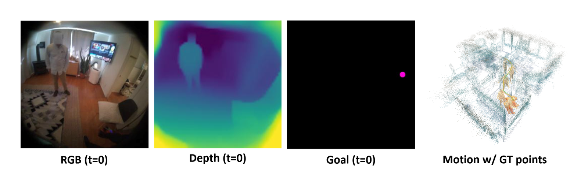
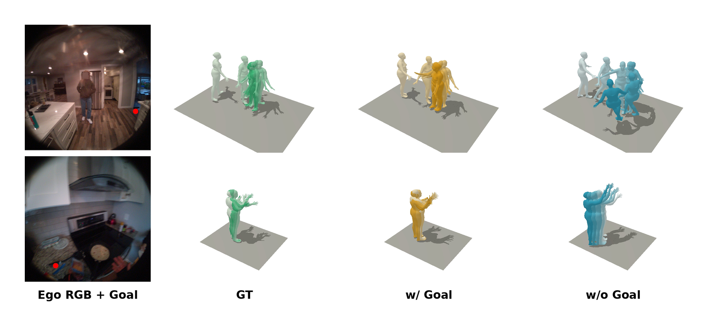

# Foresight to Motion (FoM)



Goal-conditioned autoregressive full-body (SMPL-X) motion prediction from egocentric video.
A causal Transformer decoder predicts one motion frame at a time from the previous frame, the
camera trajectory (added to the query stream) and causally masked RGB (DINOv2), depth and
goal-heatmap tokens (cross-attention). Training runs in three stages: teacher forcing,
self-forcing, and head-camera consistency.

## Setup

```bash
pip install -e ".[preprocessing,inference,visualization]"
export FOM_BODY_MODELS=/path/to/body_models     # contains smplx/SMPLX_NEUTRAL.*
export DATA=/path/to/nymeria/packed             # packed dataset (see Data)
```

SMPL-X (neutral) is required everywhere. Other locations are read from environment variables
only where they are needed: `FOM_SMPL_MODELS` (SMPL to SMPL-X refit), `FOM_VIPE_ROOT` (ViPE
depth), `FOM_TORCH_HUB` / `FOM_CACHE` (optional caches), and `FOM_BUNDLE_ROOTS` /
`FOM_NYMERIA_PLUS` (viewers). See `src/fom/paths.py`. ViPE lives in its own environment and is
only needed for depth (`--backend vipe`) and for video inference.

## Training

```bash
python -m fom.cli.train --config configs/train/stage1_teacher.yaml \
    DATA.ROOT $DATA TRAIN.EXP_DIR exp/stage1_teacher                       # 300 epochs, 1 GPU
python -m fom.cli.train --config configs/train/stage2_self_forcing.yaml \
    DATA.ROOT $DATA TRAIN.EXP_DIR exp/stage2_self_forcing \
    TRAIN.INIT_CKPT exp/stage1_teacher/epoch=299-step=70200.ckpt           # 100 epochs, 3 GPUs
python -m fom.cli.train --config configs/train/stage3_headcam.yaml \
    DATA.ROOT $DATA TRAIN.EXP_DIR exp/stage3_headcam \
    TRAIN.INIT_CKPT exp/stage2_self_forcing/epoch=59-step=18720.ckpt       # 100 epochs, 3 GPUs
```

A run resumes from `<TRAIN.EXP_DIR>/last.ckpt` when restarted. Any option can be overridden
with `KEY VALUE` pairs, e.g. `TRAIN.LR 1e-4`; `--validate-only` runs one validation pass.

## Evaluation

```bash
CFG=configs/train/stage3_headcam.yaml
python -m fom.cli.ground_truth --config $CFG --out $DATA/ee_val_gt_for_evaluation.pkl DATA.ROOT $DATA  # once
python -m fom.cli.predict --config $CFG --ckpt <ckpt> --out out/preds.pkl DATA.ROOT $DATA
python -m fom.cli.evaluate --gt $DATA/ee_val_gt_for_evaluation.pkl --preds out/preds.pkl --out out/metrics.pkl
```

`--drop-{rgb,depth,goal,traj}` on `fom.cli.predict` removes a modality at inference (Table 2).
For cross-dataset evaluation on ADT, set `DATA.ROOT` to the packed ADT set and
`DATA.STATS_PATH $DATA/v4_beta_ee_train_stats.pt` to keep the Nymeria normalization.
The stage-III checkpoint (epoch 79) gives on Nymeria val (3,439 clips):

| MPJPE | PA-MPJPE | Body | Hand | Head Rot. | Head Trans. |
|-------|----------|------|------|-----------|-------------|
| 0.213 | 0.116    | 0.166 | 0.346 | 0.417    | 0.140       |

Predicted motion placed in the Nymeria ground-truth point cloud:



Effect of the goal map (ground truth, with goal, without goal):



## Video inference

```bash
vipe infer <video>                                                   # ViPE environment
python -m fom.inference.prepare <vipe_results> <clip_id> out/<clip_id>/prep --level   # ViPE environment
python -m fom.inference.run out/<clip_id>/prep out/<clip_id>/motion \
    --config configs/train/stage3_headcam.yaml --ckpt <ckpt> DATA.ROOT $DATA
python -m fom.visualization.body_skinning out/<clip_id>/motion/motion_smplx_vipe_world.npz rig.npz
```

`fom.inference.prepare` crops the clip to a 512x512 square and, with `--level`, levels the
trajectory using a floor plane fitted in ViPE depth (recommended for real footage). `fom.inference.run`
converts the ViPE poses to the training convention, predicts 150-frame windows that overlap by 30
frames, and cross-fades them into one SMPL-X sequence. The output is in both the clip frame and the
ViPE world frame. `DATA.ROOT` is only used for the normalization statistics.

## Data

The packed Nymeria dataset is built from Nymeria-Plus episodes in three steps:

1. **Episodes** (`fom.preprocessing.nymeria.pipeline.process_episode`, one episode per call;
   `process_multi_object_episode` for multi-object goal chains): download, SMPL to SMPL-X refit,
   hand-object contacts and visible-goal sequence bundles.
2. **Packing and features**: `fom.preprocessing.packing.build_split` packs episodes into
   `ee_{train,val}.pt`, `fom.preprocessing.packing.stats` computes normalization statistics, and
   `fom.preprocessing.features.{dinov2,goal,depth}` extract DINOv2, goal-heatmap and depth features.
3. **Leak-free split**: `fom.preprocessing.packing.recenter` and
   `fom.preprocessing.packing.build_leakfree_split` build the subject- and location-disjoint split
   used in the paper (14,962 train / 3,439 val), followed by validation features and
   `fom.cli.ground_truth`.

The released training split's depth was extracted with `--backend vipe` and the validation split's
with `--backend midas`. Every module has `--help`; file names are defined in `src/fom/data/files.py`.
